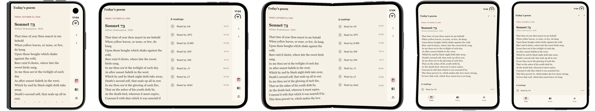

# Recital

A public-domain poem a day, read aloud by LibriVox volunteers, and a small example of
designing a Flutter app for iPhone Duo: bars in the side column, two panes on the inner
display, and nothing interactive in the fold.



Flutter 3.47 does not tell an app which display it is on, whether the device is folded,
where the fold is, or which side the bars go on. `ios/Runner/ScreenGeometryPlugin.swift`
reads those from UIKit, and `lib/core/duo/` turns them into layout:

- `screen_layout.dart` adds the fold to `MediaQuery.displayFeatures` while the device is
  partially open, so Material's dialogs, sheets and menus open beside it, and works out
  the side column.
- `page_scaffold.dart` moves Back and the page's icon actions into that column, and the
  tab shell (`lib/core/shell/`) puts the tabs at its foot.
- `fold_split.dart` puts two panes side by side, meeting at the fold, where the window is
  wide enough.

`docs/reference/iphone-duo.md` collects Apple's guidance with its sources, and
`docs/decisions/DEC-3.md` says how the app applies it. The screenshots come from the iOS
27.1 simulator.

## Running it

```sh
./scripts/bootstrap.sh     # checks the toolchain (fvm), gets packages, generates code
fvm flutter run
./scripts/gate.sh          # analysis, formatting and tests
scripts/duo/tour.sh <simulator udid> <folder>   # every screen in every iPhone Duo pose
```

Building for iOS needs Xcode 27.1. The tour presses Device Hub's pose buttons through the
macOS accessibility API, so the terminal needs Accessibility permission and the Mac has to
stay unlocked while it runs.

## Content and licence

The poems' texts come from public-domain editions on Wikisource and Project Gutenberg, and
the readings stream from LibriVox, whose recordings are in the public domain;
`assets/catalog.json` gives the source of each. The code is under the MIT licence in
`LICENSE`.
